<div align="center">

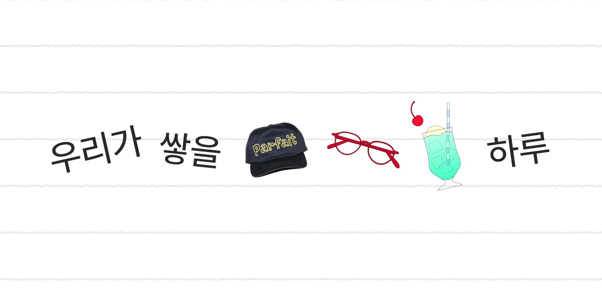

# Parfait 🍨

**우리가 쌓을 하루, 파르페**

그룹 친구들과 하루 사진을 모아 하나의 캔버스를 꾸미는 앱이에요.<br/>
오늘의 사진을 찍어 토핑으로 올려요.<br/>
서로의 하루가 한 층씩 쌓여, 하나의 캔버스로 완성돼요.

<br/>

<a href="https://play.google.com/store/apps/details?id=com.teamyg.parfait"></a>

<a href="https://github.com/mash-up-kr/TEAMYG-Android/actions/workflows/test.yml"></a>
<a href="https://github.com/mash-up-kr/TEAMYG-Android/actions/workflows/ktlint.yml"></a>


[iOS](https://github.com/mash-up-kr/TEAMYG-iOS) | [Server](https://github.com/mash-up-kr/TEAMYG-SERVER) | [기획 위키](wiki/)

<br/>

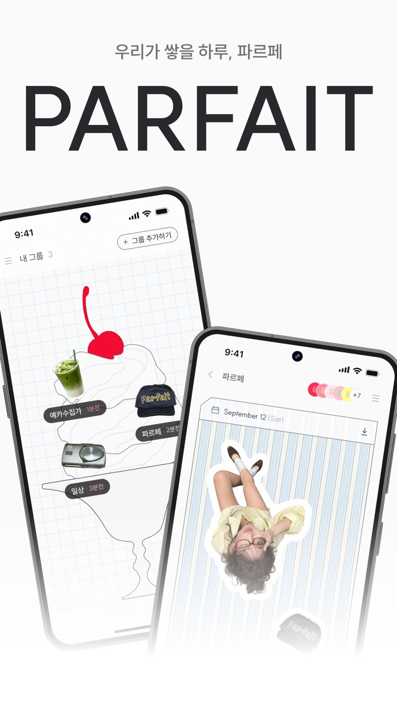

<sub><a href="https://mash-up.kr">Mash-Up</a> TEAM YG가 만들었어요</sub>

</div>

<br/>

## 🍒 주요 기능

<div align="center">

| 무한 파르페 | 순간 선택 | 자동 누끼 |
|:---:|:---:|:---:|
| 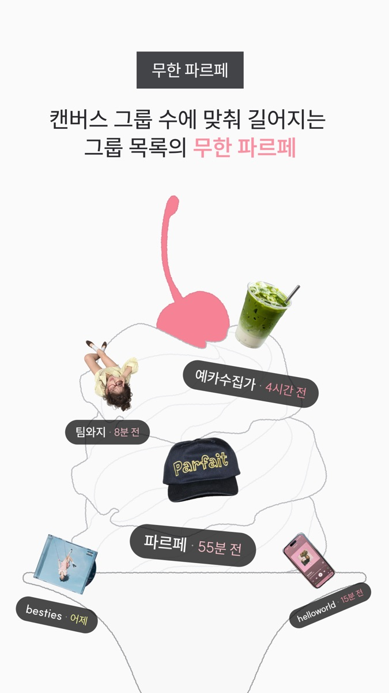 | 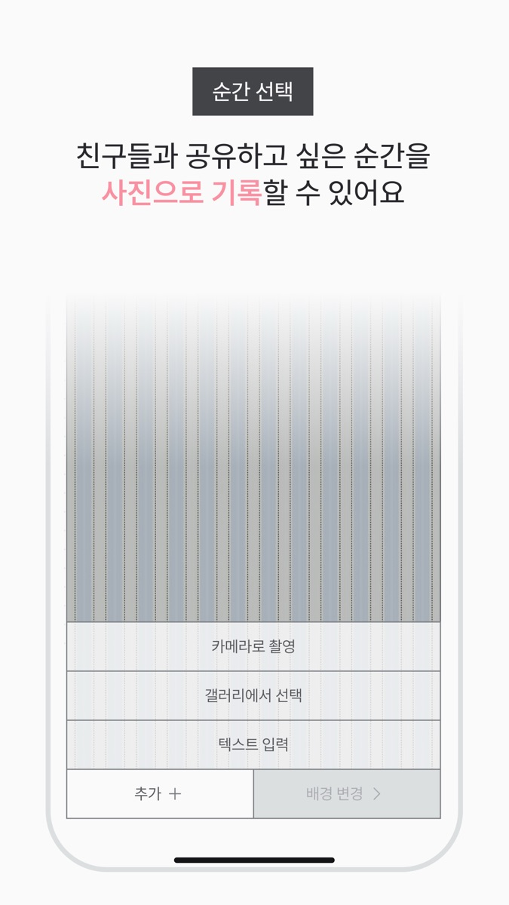 | 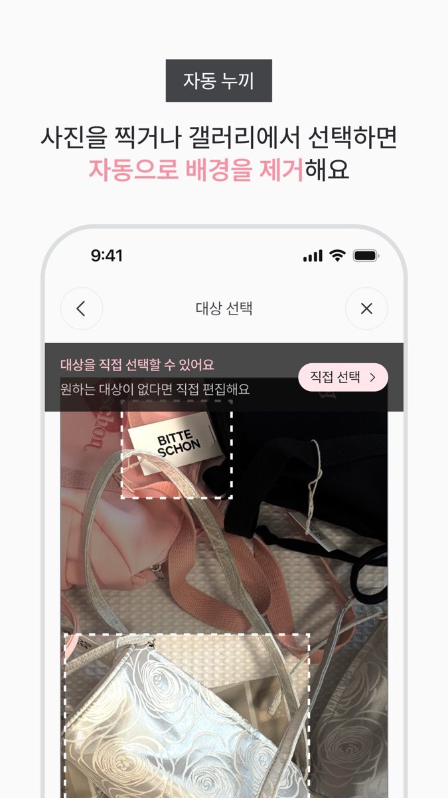 |
| 그룹이 늘면 파르페도 자라요.<br/>최근에 활동한 그룹이 맨 위로 올라와요. | 카메라, 갤러리, 텍스트 중<br/>오늘 남길 순간을 골라요. | 피사체만 쏙 잘라 토핑으로.<br/>마음에 안 들면 직접 골라요. |

| 텍스트 토핑 | 공유 캔버스 | 캔버스 알림 |
|:---:|:---:|:---:|
| 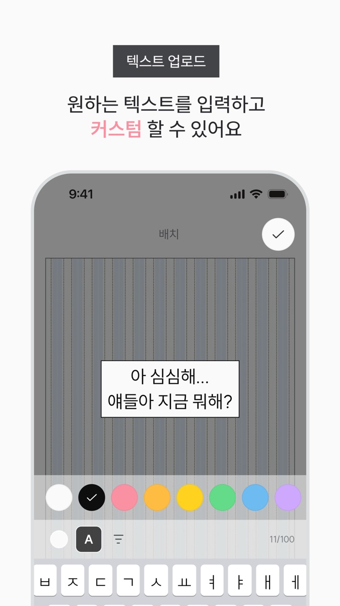 | 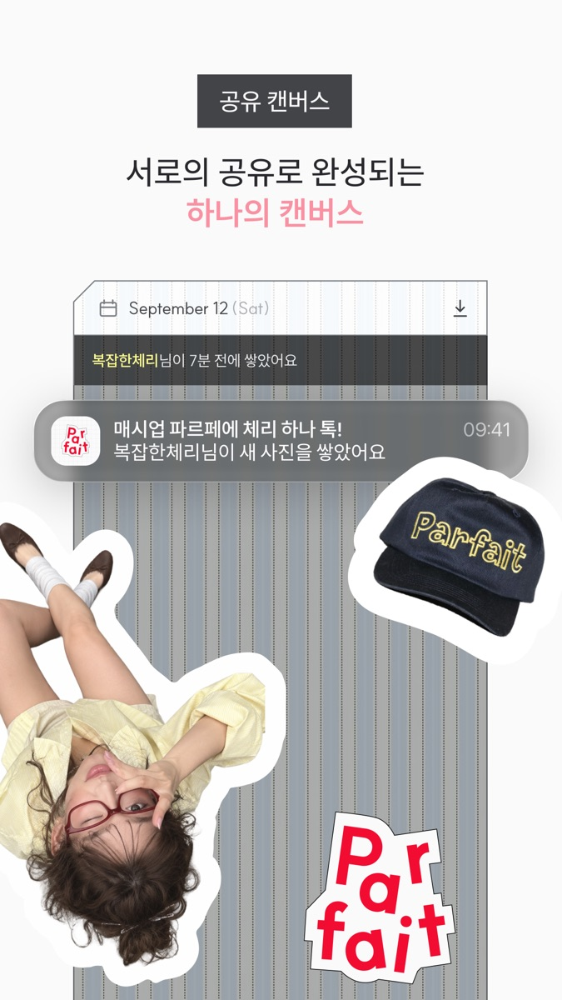 | 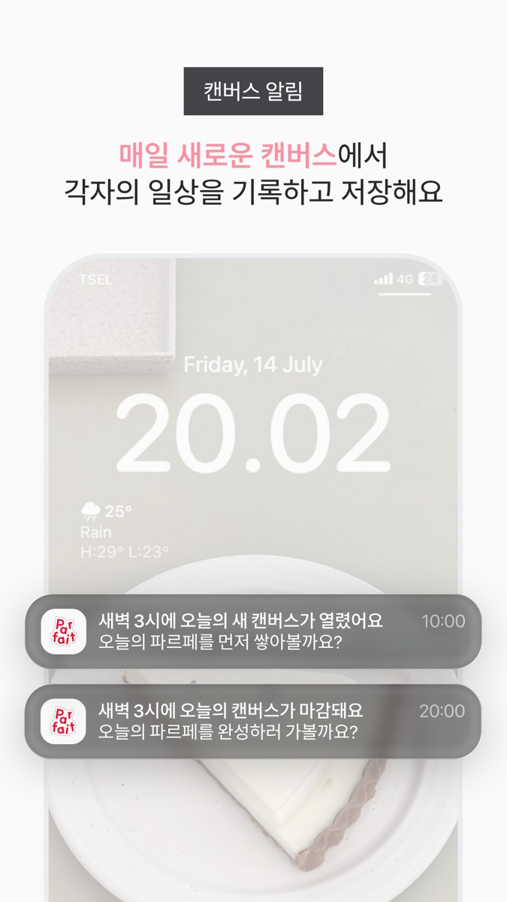 |
| 사진이 없는 날엔 말로 한 층.<br/>색과 배경을 바꿀 수 있어요. | 모두의 토핑이 하루치 캔버스에 모여요.<br/>매일 새벽 3시에 마감되고 새 하루가 열려요. | 친구가 토핑을 쌓으면<br/>바로 알림이 와요. |

</div>

<br/>

## 🎬 움직이는 파르페

<div align="center">

<sub>실기기(Galaxy A35)에서 그대로 녹화했어요. 개발용 계정이라 그룹 이름이 좀 성의 없어요.</sub>

| 파르페 내려 보기 | 캔버스 들어가기 | 말로 한 층 쌓기 |
|:---:|:---:|:---:|
| 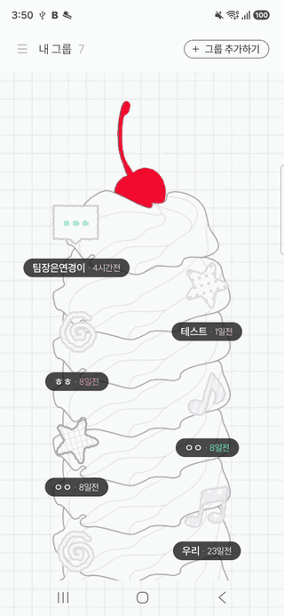 | 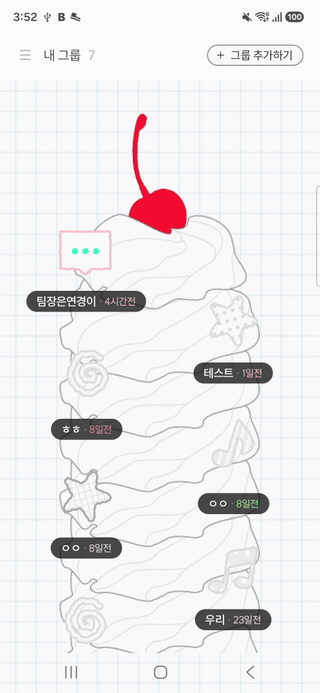 | 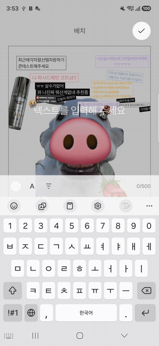 |

</div>

<br/>

## 🧁 이렇게 만들었어요

작은 앱이지만 고민은 꽤 했어요. 궁금한 것만 펼쳐 보세요.

<details>
<summary><b>✂️ 누끼는 폰 안에서 끝내요</b> <sub>ML Kit Subject Segmentation</sub></summary>
<br/>

사진에서 피사체만 잘라 내는 일을 서버 대신 기기에서 해요. ML Kit Subject Segmentation을 온디바이스로 돌려서
원본 사진을 서버로 보내지 않아도 되고, 네트워크가 느려도 기다릴 필요가 없어요. 피사체가 여럿이면 사용자가 원하는 것만 고를 수 있어요.

→ [ADR-0012 이미지 세그멘테이션](docs/adr/0012-mlkit-subject-segmentation.md)

</details>

<details>
<summary><b>🖍️ 토핑 테두리는 거리장으로 그려요</b> <sub>빨대가 여러 갈래로 갈라지던 날</sub></summary>
<br/>

처음엔 같은 그림을 여덟 방향으로 밀어 찍어 테두리를 만들었어요. 그런데 실기기에서 음료 빨대처럼 가는 부위가
여러 갈래 막대로 갈라져 보였어요. 그래서 픽셀마다 실루엣까지의 거리를 한 번 재는 **거리장**으로 바꿨어요.
테두리는 굵기와 상관없이 매끈해졌고, 토핑 하나 그리는 횟수도 9번에서 2번으로 줄었어요. 터치 판정도 같은 거리장을 써요.

→ [ADR-0030 토핑 외곽선 거리장](docs/adr/0030-topping-outline-distance-field.md)

</details>

<details>
<summary><b>🎞️ 캔버스를 영상으로 저장해요</b> <sub>외부 라이브러리 없이 MediaCodec</sub></summary>
<br/>

토핑이 쌓인 순서대로 하나씩 나타나는 영상을 만들어 갤러리에 저장해요. 화면에는 그리지 않는 녹화용 레이어를
한 벌 띄우고, 프레임마다 캡처해서 `MediaCodec`과 `MediaMuxer`로 mp4를 직접 만들어요.
화면 속 캔버스와 영상 속 캔버스가 픽셀까지 같아야 해서, 화면 렌더 코드를 그대로 썼어요.

→ [ADR-0035 캔버스 동영상 인코딩](docs/adr/0035-canvas-video-onscreen-capture-encoding.md)

</details>

<details>
<summary><b>👀 친구가 올린 토핑이 저절로 나타나요</b> <sub>캔버스는 한 곳에서 관리하고 폴링</sub></summary>
<br/>

캔버스를 쓰는 화면이 셋인데, 각자 따로 서버를 부르면 한 화면이 받은 최신 값이 다른 화면에 닿지 않아요.
오늘의 캔버스를 저장소 한 곳에 두고, 화면이 구독하는 동안만 주기적으로 새로 받아 와요.
캔버스를 열어 두기만 해도 친구의 토핑이 올라와요.

→ [ADR-0029 오늘 캔버스 SSoT와 폴링](docs/adr/0029-canvas-today-ssot-polling.md)

</details>

<details>
<summary><b>📸 PR마다 Before / After를 CI가 찍어 줘요</b> <sub>Roborazzi 스크린샷 비교</sub></summary>
<br/>

UI를 바꾼 PR에 전후 스크린샷을 직접 붙이는 건 자꾸 까먹게 돼요. 그래서 CI가 같은 잡 안에서 base와 PR을 각각
Roborazzi로 렌더하고, 바뀐 `@Preview`만 골라 PR 코멘트로 달아요. 바뀐 화면이 없으면 새 코멘트를 달지 않아요.

→ [ADR-0037 PR 스크린샷 비교](docs/adr/0037-pr-screenshot-diff-in-job-base-render.md)

</details>

<details>
<summary><b>📚 왜 그렇게 했는지는 글로 남겨요</b> <sub>ADR과 기획 위키</sub></summary>
<br/>

처음부터 그랬던 건 아니에요. 프로젝트 중반부터 결정을 글로 남기기 시작했고, 그 전에 내린 결정도 되짚어서 정리했어요.
큰 결정은 [ADR](docs/adr/README.md)로, 설계와 구현 계획은 [`docs/`](docs/index.md)로, 기획과 정책은 [위키](wiki/)로 남겨요.
"이거 왜 이렇게 했어요?"의 답을 코드 밖에서도 찾을 수 있게 하려고요.

</details>

<br/>

## 📦 구조

```text
　　　 ∧＿∧
　　　( ･ω･｡)つ━☆・*。
　　　⊂　  ノ 　　　・゜+.
　　　 しーＪ　　　°。+ *´¨)
　　　　　　　　　.· ´¸.·*´¨) ¸.·*¨)
　　　　　　　　　(¸.·´ (¸.·'*    com.teamyg.parfait
                                 ├── build-logic
                                 ├── app
                                 ├── app-preview
                                 ├── core
                                 │   ├── analytics
                                 │   ├── designsystem
                                 │   ├── ui
                                 │   ├── navigation
                                 │   ├── testing
                                 │   │   └── android
                                 │   └── util
                                 │       ├── android
                                 │       └── jvm
                                 ├── feature
                                 │   ├── intro
                                 │   ├── login
                                 │   ├── camera
                                 │   ├── gallery
                                 │   ├── segmentation
                                 │   ├── groups
                                 │   │   ├── list
                                 │   │   ├── enter
                                 │   │   ├── canvas
                                 │   │   └── setting
                                 │   ├── app
                                 │   │   ├── notice
                                 │   │   └── setting
                                 │   └── common/terms
                                 ├── data
                                 └── domain
```

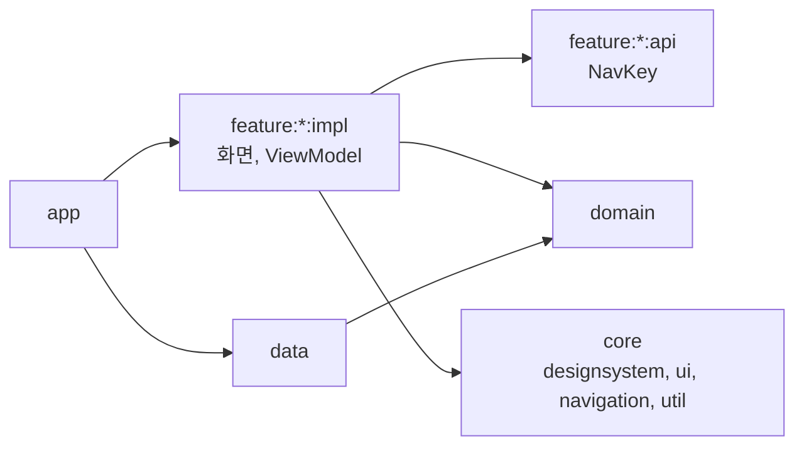

- `feature` 아래 기능마다 `api`(NavKey)와 `impl`(화면, ViewModel) 두 모듈로 나눠요. 기능 사이를 이동할 때는 상대 기능의 `api`만 의존해요.
- 레이어별 설명은 [아키텍처 문서](docs/architecture/README.md)에 있어요.

<br/>

## ⚒️ 기술 스택

<div align="center">

</div>

<br/>

| 분류 | 사용 기술 |
|---|---|
| 아키텍처 | Clean Architecture, 멀티 모듈, MVI(직접 만든 `BaseViewModel`) |
| 언어, 비동기 | [Kotlin](https://kotlinlang.org/), [Coroutines](https://github.com/Kotlin/kotlinx.coroutines) + Flow, [kotlinx.serialization](https://github.com/Kotlin/kotlinx.serialization), [kotlinx-datetime](https://github.com/Kotlin/kotlinx-datetime) |
| UI | [Jetpack Compose](https://developer.android.com/jetpack/compose) + Material 3, [Navigation 3](https://developer.android.com/guide/navigation/navigation-3), [Coil 3](https://github.com/coil-kt/coil), [Lottie](https://github.com/airbnb/lottie-android) |
| 의존성 주입 | [Hilt](https://dagger.dev/hilt/) |
| 네트워크 | [Retrofit](https://github.com/square/retrofit) + [OkHttp](https://github.com/square/okhttp) |
| 카메라, 이미지 | [CameraX](https://developer.android.com/training/camerax), [ML Kit Subject Segmentation](https://developers.google.com/ml-kit/vision/subject-segmentation), MediaCodec |
| 공유, 유입 | Instagram 스토리 공유, [Play Install Referrer](https://developer.android.com/google/play/installreferrer) |
| 저장, 인증 | [DataStore](https://developer.android.com/topic/libraries/architecture/datastore), [Kakao 로그인](https://developers.kakao.com/docs/latest/ko/kakaologin/android) |
| 관측 | [Firebase](https://firebase.google.com/) Analytics, Crashlytics, Cloud Messaging, [Kermit](https://github.com/touchlab/Kermit) |
| 테스트 | JUnit4, kotlin.test, [MockK](https://mockk.io/), [Turbine](https://github.com/cashapp/turbine), MockWebServer, [Roborazzi](https://github.com/takahirom/roborazzi) + [Robolectric](https://robolectric.org/) + [ComposablePreviewScanner](https://github.com/sergio-sastre/ComposablePreviewScanner) |
| 빌드, 품질 | [컨벤션 플러그인](build-logic), [버전 카탈로그](gradle/libs.versions.toml), [ktlint](https://github.com/JLLeitschuh/ktlint-gradle), GitHub Actions |

<br/>

## 👥 팀원

<div align="center">


<br/>
<br/>

<table>
<tr>
<td align="center">
<a href="https://github.com/citytexi"></a>
<br />
<b>전희훈</b>
<br />
<sub>👑 대 장 님 👑</sub>
</td>
<td align="center">
<a href="https://github.com/moonsbsb"></a>
<br />
<b>문설빈</b>
<br />
<sub>인턴1</sub>
</td>
<td align="center">
<a href="https://github.com/JeonK1"></a>
<br />
<b>전계원</b>
<br />
<sub>인턴2</sub>
</td>
</tr>
</table>

</div>

<br/>

---

<div align="center">


프로젝트 잘 되게 해주세요

</div>
