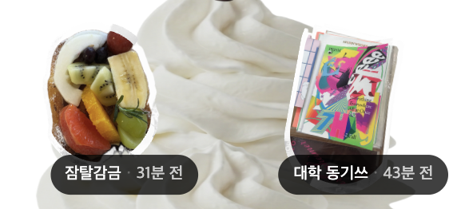

# 무한 파르페

## 정의

`G-001`(그룹 목록)의 시각 구조다. 화면 전체가 **파르페 잔 하나**이고, 가입한
그룹이 늘수록 잔이 아래로 무한히 길어진다. 각 그룹은 자기 대표 토핑 한 개로
잔 위에 올라간다.

제품명 parfait와 [[canvas]] 위의 "토핑"에 이어, **디저트 은유가 화면 구조까지
내려온 지점**이다.

**현행 정본은 [[src-G-001-무한파르페-정책-v0.4]](09-20)이다.** 문서명이 "정책
설계"에서 "정책"으로 바뀌었지만 같은 계열이고, 개정이력이 `v0.1`(06-13)부터 이어
받는다. **기능정의서 v7(운영 v1.0.1)을 읽고 맞춘 판본**이다 — 정렬 동률 규칙,
`G-001-Error`, 템플릿 고정, Timestamp 컬러, PTR 로딩을 들였고, 맞출 수 없는 셋은
"클라이언트 확인 필요"로 표시했다(아래 "정책서와 v7이 어긋나는 셋").

`G-001`은 6월 이후 문서가 배치·간격·토핑으로 갈라졌다가 정책설계 `v0.2`에서
**다시 한 문서로 합쳐졌고**, 그 뒤 툴팁·빈 토핑 템플릿·Empty 애니메이션이 각자
전용 문서를 얻었다. **`v0.4`가 대체를 선언한 것은 정책설계 계열 하나뿐**이라 나머지는
내용이 겹쳐도 `current`로 남는다.

| 문서 | 날짜 | 지위 |
|---|---|---|
| [[src-G-001-무한파르페-정책-v0.4]] | 09-20 | **현행 정본** |
| [[src-G-001-무한파르페-정책설계-v0.3]] | 07-24 | 🔁 `v0.4`로 대체 |
| [[src-G-001-무한파르페-정책설계-v0.2]] | 07-24 | 🔁 `v0.3`으로 대체 |
| [[src-G-001-무한파르페-간격-정책-v0.3]] | 07-27 | `current`. **인셋 4**, 정렬 타이브레이크 |
| [[src-G-001-무한파르페-간격-정책-v0.2]] | 07-22 | 🔁 `v0.3`으로 대체 |
| [[src-G-001-토핑-정책-v0.1]] | 07-09 | `current`. **규격과 오버플로우가 뒤집혔다** |
| [[src-G-001-무한파르페-정책설계]] | 06-13 | 🔁 `v0.2`로 대체 |
| [[src-G-001-무한파르페-간격-정책-v0.1]] | 07-09 | 🔁 간격 `v0.2`로 대체 |
| [[src-G-001-Empty-툴팁-노출-조건-정책-v0.1]] | 07-22 | `current`. 툴팁 노출·닫기 조건 |
| [[src-G-001-Empty-동작-명세-v0.3]] | 10-05 | `current`. Empty 애니메이션과 닫기. 툴팁 `v0.1`과의 판본 관계 미정 |
| [[src-G-001-그룹-토핑-템플릿-정책-v0.2]] | 07-26 | `current`. **템플릿 6종 교체**, 에셋 시트 |
| [[src-G-001-그룹-토핑-템플릿-정책-v0.1]] | 07-25 | 🔁 템플릿 `v0.2`로 대체 |

정책설계 `v0.2`·`v0.3`은 원본에 날짜가 없었는데, `v0.4` 개정이력이 둘을
**07-24 최종 확정본**으로 묶었다.

### 회의에서 정해진 것

화면의 뼈대는 정책서보다 회의가 먼저 정했다.

- **06-04** — "그룹 개수에 따라 파르페 길이가 늘어나도록, 파르페 토핑처럼 배치"
  ([[src-회의록-2026-06-04-회의]]). 무한 파르페의 원점이다.
- **06-11** — 홀수 줄 2개 / 짝수 줄 1개, 이미지 없는 날 디폴트 이미지
  ([[src-회의록-2026-06-11-회의]]). 뒤에 폐기된 `2-1-2-1`의 출발점이다.
- **06-18** — 결정표 13건: 활동순 정렬, Empty Case, 에러 문구·새로고침·풀투리프레시,
  진입 시 재조회, **캐싱 불필요**, **그룹명 px 기준 말줄임**, 상대 시간 5단계, NEW는
  `C-001` 진입 시 해제, Z-index 접시1 < 크림2 < 체리3 < 토핑·라벨4
  ([[src-회의록-2026-06-18-회의]]). 결정표 9번 **"토핑 — MVP 제외"**가 정책 9.2의
  무엇을 가리키는지는 회의록에 없다([[open-questions]]).

## 구성 요소

| 요소 | 무엇 | z-index |
|---|---|---|
| 토핑 (`Img` + `Grouptag-Chip`) | 그룹 대표 이미지와 이름 칩 | 4 |
| 체리 | 기능 없음. `TBD` | 3 |
| 크림 | 토핑이 얹히는 바탕. 그룹 수만큼 늘고 준다 | 2 |
| 접시 | 기능 없음. 잔의 바닥 | 1 |

체리와 접시는 지금 아무 동작도 하지 않는다. 그래도 z-index가 배정된 것은 장식이
레이어로 관리된다는 뜻이다.

토핑 안에서는 **`Img`가 `Grouptag-Chip`보다 위**다
([[src-G-001-토핑-정책-v0.1]]).

## 토핑 컴포넌트

| 항목 | 현행 ([[src-G-001-무한파르페-정책-v0.4]]) | 토핑 정책서 (07-09) |
|---|---|---|
| 토핑 프레임 | **160×160** | 180×180 |
| `Img` | **96×96**, 프레임 정중앙 | 144×144 |
| 타입 수 | **6** | 3 |

> ⚠️ [2026-09-17] [[src-G-001-토핑-정책-v0.1]] 이 상충 — 160×160이 뒤 문서
> **둘에서 재확인돼 규격 다툼은 사실상 끝났으나**, 어느 문서도 토핑 정책서를
> 대체한다고 선언하지 않아 그 문서가 `current`로 남는다 → [[open-questions]]

`Img`가 프레임의 60%로, 이전 80%보다 여백이 넓어졌다.

토핑은 **`Img` + `Grouptag-Chip`**이고 `Chip`은 회전하지 않는다. Z는 항상
**`Img` > `Grouptag-Chip`**이다.

**`Chip`의 배치 기준점은 "프레임 중앙 하단 / `Img` 중앙 하단"이다.** v7이 먼저
적었고 [[src-G-001-무한파르페-정책-v0.4]]가 정책서 계열에 되돌려 놓았다. 정책설계
`v0.2`·`v0.3`에서는 항목째 빠져 있었다. [[src-G-001-무한파르페-간격-정책-v0.3]]만
여전히 `[ A / B ]` 택일 표기로 남는다.

### 타입마다 고정 변형이 붙는다

정중앙(오프셋 0) 기준으로 타입이 값을 정한다. **사용자 데이터가 아니다.**

| 타입 | Translate X | Translate Y | Rotate | Chip Offset |
|---|---|---|---|---|
| `Left-1` | 26 | 16 | **6°** | -7 |
| `Left-2` | 24 | 11 | **12°** | -5 |
| `Left-3` | 25 | 16 | **-8°** | -8 |
| `Right-1` | 26 | 16 | **-6°** | -6 |
| `Right-2` | 22 | 8 | **-16°** | -3 |
| `Right-3` | 25 | 16 | **-8°** | -8 |

`Left-3`와 `Right-3`가 값이 완전히 같다. 의도인지 복사 흔적인지 알 수 없다.

**`1`·`2`·`3`은 랜덤이다.** 인덱스 규칙은 좌우만 가르고, `Left` 토핑은
`Left-1~3`, `Right` 토핑은 `Right-1~3` 중 하나를 **랜덤 부여**받는다
([[src-G-001-무한파르페-정책-v0.4]]).

정책설계 `v0.2`는 반대로 "변형 시드는 그룹 ID 고정이라 유지"라 적었고, `v0.3`이
그 서술을 이름까지 들어 **폐기**했다.

정렬이 활동 최신순이라 **새로고침으로 순서가 바뀌면 타입도 바뀐다.** 3번째
활동이던 그룹이 `Left-3`이었다가 5번째로 밀리면 `Left-1`·`2`·`3` 중 하나로 다시
정해진다.

**재추첨 시점은 목록 조회 응답 1회다.** 리렌더나 셀 재사용에서 다시 뽑는 것은
금지이고, **근거가 적혀 있다** — "회전각 튐 방지". 스크롤만 해도 토핑이 흔들리는
것을 막는다.

`C-305`에서 사용자가 준 토핑 각도([[canvas]])가 이 고정 회전과 어떻게 합쳐지는지는
정해지지 않았다.

### 프레임 밖으로 나가지 않는다 (정책이 뒤집혔다)

**현행**: 96 `Img`는 160 프레임을 회전·이동해도 **벗어나지 않는다.**
[[src-G-001-무한파르페-정책설계-v0.2]]가 그렇게 적고 **"구 clip OFF/삐짐 노출
정책 삭제"**를 명시한다.

**직전까지는 반대였다.** [[src-G-001-토핑-정책-v0.1]]은 144 `Img`가 180 프레임을
넘어간다고 보고 **삐져나온 부분을 그대로 노출**하도록(`Clip Contents OFF`) 정했다.
프레임 경계에서 잘라내는 것은 "이건 아님!"이라고 못박았고, **근거까지 적었다** —
삐져나온 픽셀은 인접 토핑을 밀지 않으므로 다 노출해 자연스러운 분위기를 살린다.

**전제가 무너져 물음이 사라진 것이다.** 144/180은 80%라 넘치고 96/160은 60%라
넘치지 않는다. 근거가 틀렸다고 적힌 것은 아니다 — **이 위키가 받은 "근거가 적힌
결정" 둘 중 하나가 이렇게 없어졌다**([[spec-version-history]]).

간격은 프레임 기준으로 잰다.

## 지그재그 배치

**행당 토핑 하나**를 좌/우로 번갈아 놓고 아래로 무한히 잇는다.

```
[ Left ]
         [ Right ]
[ Left ]
         [ Right ]
```

인덱스를 0부터 셀 때 **2개 단위로 반복**한다.

| `index % 2` | 자리 |
|---|---|
| 0 | `Left` |
| 1 | `Right` |

**`index 0`은 `Left` 고정이다** — 간격 `v0.2`가 `[ Left / Right ]`로 남긴 택일을
[[src-G-001-무한파르페-정책설계-v0.2]]가 골랐다.

[[src-기능정의서-v7]]과 [[src-G-001-무한파르페-정책-v0.4]]도 같은 값이다 —
**"index % 2 = 0 → Left, 1 → Right(첫 토핑 Left 고정 시작)"**.

**간격 계열만 그 확정을 받지 않았다.** [[src-G-001-무한파르페-간격-정책-v0.3]]이
여전히 `[ Left / Right ] 고정`으로 적는다 — 개정이력의 변경 목록에 그 절이 없으므로
**손대지 않은 채 이어받은 것**으로 읽는다. 정렬 타이브레이크·Chip 기준점은 `v0.4`가
받아 반대 방향 전파는 해소됐고, **간격 계열 쪽 미정 표기만 남는다**
([[open-questions]]).

### 좌표

[[src-G-001-무한파르페-정책설계-v0.2]]가 처음으로 숫자를 적었다. 그 전까지는
"프레임 기준으로 잰다"는 측정 규칙만 있었다.

**좌표 컨테이너는 크림이 아니라 파르페 템플릿 전체다** — 체리부터 접시까지를
포함한 고정 이미지 영역이고 가로가 **324.3**이다. 화면 기준이 아니다
([[src-G-001-무한파르페-정책설계-v0.3]]).

| 항목 | 값 |
|---|---|
| 기준 x | 템플릿 기준 좌/우 인셋 **4** (`Left` x=4, `Right` x=160.3) |
| 첫 토핑 y | **280** (`N` ≤ 3, 스크롤 없음) / **268** (`N` ≥ 4) |
| 같은 side 세로 갭 | **-12** — 프레임 160이므로 y 간격 148 |
| `Left` 열 | y = 268, 416, 564, … |
| `Right` 열 | y = 354, 502, 650, … |

템플릿 고정 갭은 셋이다 — 체리↔첫 토핑 **-65**, 마지막 토핑↔접시 **-48**,
접시↔스크롤 인디케이터 **최소 -16**(스크롤이 생길 때만).

변형 번호는 세로 갭에 영향을 주지 않는다. 같은 side면 -12로 같다.

`Left`↔`Right` 가로 관계는 **3.7(겹침)**이고 템플릿 폭에서 나오는 **파생값**이라
직접 지정하지 않는다.

**토핑과 칩이 크림 폭을 넘는 것은 정상 동작이다.** 경계는 크림이 아니라
템플릿이다.

`Chip` 기준점("프레임 중앙 하단 / `Img` 중앙 하단")은 **두 정책서 계열 어디도 닫지
못한 것을 v7이 먼저 닫고 `v0.4`가 받아 간** 항목이다. 같은 자리에 **"Chip 회전
없음"**, **"Z는 항상 Img > Chip"**도 있다.

**인셋은 28이었다가 4가 됐다.** [[src-G-001-무한파르페-간격-정책-v0.3]](07-27)이
먼저 바꿨고 [[src-G-001-무한파르페-정책설계-v0.3]]이 기준까지 밝히며 확정했다.

**`Right`는 `Left y + 86`이다.** `v0.2`가 "인접한 두 `Left` 토핑의 가운데
높이"라 적어 산술이 맞지 않았는데(268과 416의 가운데는 342인데 값은 354),
[[src-G-001-무한파르페-정책설계-v0.3]]이 **"실측 기준 `Left y + 86`"**이라 직접
적어 닫았다. 표현도 "가운데"에서 "**사이**"로 바뀌었다.

### 2-1-2-1은 폐기됐다

`v0.2` 이전의 배치는 2열과 1열을 섞는 "`2-1-2-1` 스태거"였다. 세 문서가 **2열이
먼저냐 1열이 먼저냐**를 두고 갈렸는데, `v0.2`가 패턴 자체를 없애면서 그 다툼이
끝났다 — 어느 쪽이 맞는지 밝혀진 것이 아니라 물음이 사라졌다.

같은 이유로 `Type 1` / `Type 2-Left` / `Type 2-Right` 체계와 그에 딸린 갭 표
(좌우가 12px 어긋나던 스태거)도 함께 무효가 됐다. 경위는
[[spec-version-history]]에 있다.

### 저개수

- **N = 0** — 토핑 없음. 크림 기본 3개 + 접시(v7은 "크림 최소", 아래 표). 안내는
  **`G-001-Empty`**가 맡는다(아래 "빈 상태").
- **N = 1 ~ N = 3** — **스크롤이 생기지 않는 구간**이고 파르페도 늘어나지 않는다.
  `N` ≥ 4 배치 대비 **각 토핑 y를 +12 내린다.** x는 같다.
  정책설계 `v0.2`는 `N = 1`·`N = 2`만 +12였는데 `v0.3`이 `N = 3`을 이 무리에 넣고
  기준을 "스크롤 발생 여부"로 다시 적었다.
- **N = 4 이상** — 스크롤이 생기고 크림이 토핑 하나당 하나씩 늘어난다.

#### 정책서와 v7이 어긋나는 셋

[[src-G-001-무한파르페-정책-v0.4]]가 **직접 표로 나란히 적었다.**

| 항목 | 정책서(`v0.3`) | 기능정의서 v7 |
|---|---|---|
| N = 0 크림 | **기본 3개** + 접시 | 크림 **최소** + 접시 |
| N = 3 | 스크롤 없음, 각 토핑 y **+12** | "N=3까지 스크롤 없음" — **+12 여부 미기재** |
| 접시 ↔ 스크롤 인디케이터 | 최소 **16** | 최소 **-16** |

셋 모두 **"클라이언트 확인 필요 — 실제 운영 값으로 정책서와 기능정의서를
맞춘다"**로 끝난다. **문서끼리 판정하지 않고 구현을 기준으로 삼겠다는 선언이다.**
운영 값이 무엇이었는지는 아직 어느 소스에도 없다. 접시 갭 부호는 이 위키가 이미
붙들고 있던 어긋남이다([[open-questions]]).

### 빈 상태 (`G-001-Empty`)

**조건은 가입 그룹 0건 자체다.** 최초 1회 플래그를 쓰지 않고, 닫아도 저장하지
않아 **0건이면 재진입할 때마다 다시 나온다** — 그룹을 만들거나 합류하기 전까지
영구히 끄는 장치가 없다([[src-G-001-Empty-툴팁-노출-조건-정책-v0.1]]).
[[src-G-001-무한파르페-정책-v0.4]]가 위치와 모양을 더했다 — **`+ 그룹 추가하기`
버튼 아래, 꼬리는 위**, X 없음, 딤·드롭섀도 없음.

**10/15 배포된 UX_1에서 빈 상태가 연출이 됐다.** [[src-회의록-2026-09-29-회의]]가
UX_1 범위를 "토핑 추가/편집 플로우 + `G-001` Empty Case 개선"으로 정했고
[[src-회의록-2026-10-20-회의]]가 배포를 확인했다. 그 동작은
[[src-G-001-Empty-동작-명세-v0.3]](10-05)이 정한다.

- 0건으로 진입할 때마다(탭 전환 포함) **1회 재생**한다.
- **더미 그룹 셋**이 좌상·우중·좌하 순서로 0.5초 간격, 각 1,000ms 동안 Y `-60 → 0`
  이동과 페이드 인(`cubic-bezier(0, 0, 0, 1)`). 지그재그 배치를 빈 목록에서 미리
  보여 주는 셈이다.
- 안내 말풍선은 2,500ms에 500ms 페이드 인(Spring mass 1 / stiffness 80 /
  damping 20).
- 도중에도 햄버거·`그룹 추가하기`는 동작하고, `그룹 추가하기`를 누르거나
  백그라운드에서 돌아오면 재생 완료 상태가 된다.
- **화면을 탭하면 더미 그룹과 툴팁이 함께 0.3초 디졸브로 사라진다.**

> ⚠️ [2026-11-13] [[src-G-001-Empty-툴팁-노출-조건-정책-v0.1]] 와 상충 — 닫기가
> 그쪽(과 `v0.4`)은 **툴팁 외 영역 클릭**, 동작 명세 `v0.3`은 **화면 탭**이다.
> 동작 명세의 개정이력이 "닫기 조건 변경"이지만 그 `v0.1`·`v0.2`가 위키에 없고
> 제목·작성자도 달라, 툴팁 문서를 잇는 계열인지는 정해지지 않았다 → [[open-questions]]

**문구는 어느 문서에도 없다.** 동작 명세도 위치("상단 안내 말풍선")와 타이밍만
적는다. 1차 UT 뒤 Empty에 **그룹 생성 유도 팝업**을 넣었다는 기록이 있는데
([[src-회의록-2026-08-27-회의]]), 그것이 이 툴팁인지도 적히지 않았다.

Figma 그룹 목록 주석이 둘을 더한다 — **Error Case에서는 `그룹 추가하기` 버튼을
보이지 않고**, 스크롤하면 **안내 텍스트와 파르페 템플릿이 함께 내려간다**
([[src-figma-주석-그룹-목록-G-001]]).

[[src-G-001-무한파르페-정책설계]]가 `N = 0`에 적은 문구
`"첫 그룹을 만들어 / 파르페를 쌓아보세요"`가 그 툴팁의 내용인지는 여전히 없다.
**그 문구가 놓이던 자리(크림 상단 42% 지점)는
[[src-G-001-무한파르페-간격-정책-v0.3]]이 폐기를 명시했다.**
`N = 1`의 "가운데 1개"는 지그재그와 y +12 보정으로 대체된 것으로 읽는다.

### 크림 개수

| 토핑 | 크림 |
|---|---|
| 0 ~ 3 | **3 고정** |
| 4 | 4 |
| 5 | 5 |
| N (≥ 4) | N |

### 그룹을 나가면 당겨진다

**빈자리를 남기지 않는다.** 나간 토핑 뒤의 것들이 가입순 그대로 한 칸씩 올라오고,
`N` → `N−1`로 패턴 전체가 재계산된다. 크림은 그만큼 수축하며 접시가 위로 올라온다.

**당겨진 지점 이후 모든 토핑의 좌/우가 뒤집힌다.** side가 `index % 2`이므로 한 칸
당겨지면 `Left`였던 것이 `Right`가 되고 타입과 회전도 따라 바뀐다.
[[src-G-001-무한파르페-정책설계-v0.2]]가 이것을 **"버그 아니라 정상 동작"**이라고
직접 적었다 — 구현자가 결함으로 신고할 자리에 미리 답을 단 것이다.

**변형 번호도 함께 랜덤 재부여된다** — side와 타입·회전이 같이 바뀐다
([[src-G-001-무한파르페-정책-v0.4]]). 나가기 시 전체 재조회는 06-18 결정표에도
있다.

반영은 저장·화면 재진입 시점이다. **실시간이 아니다** — 기존 동기화 정책을
따른다. 도메인 쪽 서술은 [[group]]에 있다.

## 라벨

이름 칩은 한 줄 고정이고 토핑 우측 하단에 붙는다. 칩 폭은 토핑 폭에 종속되지
않고 내용 기준으로 늘어난다.

- **그룹 이름은 80px 초과분부터 `…` 처리한다.**
  [[src-G-001-무한파르페-정책설계-v0.2]]가 확정하며 **"구 6자/7자 문자수 기준
  폐기"**를 명시했다. 배치 정책서(06-13)의 "최대 6자, 7자 이상이면 앞 5자 + `…`"
  (예: `우리동네산책모임` → `우리동네산…`)는 더는 쓰지 않는다. **다만 80px에 몇
  자가 들어가는지는 여전히 없다.**
- 시간 텍스트(`· N분 전`)는 **항상 전체 노출**하고 줄이지 않는다.
- 그 **Timestamp 텍스트 컬러**는 마지막으로 변화를 가한 사람의 `Nametag-Chip`
  타입을 따른다([[src-S-101-프로필-이미지-및-그룹칩-내-타임스탬프-컬러-규칙-v0.1]]).
  [[src-G-001-무한파르페-정책-v0.4]]가 같은 표를 **본문에 직접 실어**, 앞 판본들이
  옛 문서명을 가리키던 참조 빗나감이 끝났다. 그룹 단위 규칙이고 개별 멤버 컬러
  규칙(`S-101`)과는 별개라고 적는다. **매핑 대상은 `Nametag-Chip` 타입이고 표만
  다르다.**

  | 컬러 (타입) | Timestamp | 토스트 닉네임 |
  |---|---|---|
  | 연핑크 (Type 1, 2) | **Cherry-100** | Cherry-200 |
  | 진핑크 (Type 3, 4) | **Cherry-200** | Cherry-300 |
  | 체리 (Type 5, 6) | **Cherry-300** | Cherry-400 |
  | 그레이 (Type 7, 8) | White | White |
  | 멜론 (Type 9, 10) | Melon | Melon |
  | 푸딩 (Type 11, 12) | Pudding | Pudding |

  Cherry 계열만 한 단계씩 어긋난다. 원본이 **"서로 다른 UI 요소용 별개
  매핑이므로 상충이 아니다"**라고 직접 적었다.

  **칩을 정상 결정할 수 없으면 이 표를 쓰지 않는다.**
  [[src-S-101-프로필-닉네임-컬러-규칙-v0.4]](08-17)가 `Nametag-Chip`에 **Default
  상태**를 더했고, 그 예시에서 `Grouptag-Chip`은 닉네임 자리에 **"알수없음"**을
  쓴다(`알수없음  59분전`). **탈퇴한 그룹원이 대표적이다** — 이미지 주석이
  "탈퇴했으면 무조건 이름 알수없음임"이다([[account]]).

  **다만 그 문서의 적용 범위에 `Grouptag-Chip`이 없다.** `v0.3`이 별도 문서로
  이관했고 이관처는 07-17자라 Default를 알지 못한다. **Default가 이관 경계를
  넘는데 규칙이 범위 밖 컴포넌트의 예시로만 적혀 있다**([[open-questions]]).

  칩이 12종인데 [[group]] 최대 인원도 12명이라 **목록에서 같은 색이 여럿 보일 수
  있다**([[account]]).

**입력 한도는 10자다**([[src-A-005-그룹명-정책-v0.1]]). 표시 한도가 6자든 80px든
입력 가능 범위의 상당 부분이 목록에서 잘린다. 의도된 것인지 서술이 없다.

이것은 목록 칩의 표기 규칙이지 닉네임 정책이 아니다. 그룹 내 닉네임은 별개로
1~15자다([[group]]).

**칩에 닉네임이 들어올 수 있다.** Figma Development 페이지의 09-21 `G-001` 개선
방향이 **그룹 칩에 올린 사람의 닉네임을 함께 노출**하자고 적었다 — 칩이 최신 토핑
사진만 보여 **"어떤 기준으로 사진이 노출되는지 이해하기 어렵다는 피드백"**이
있었다는 것이 근거다. 같은 자리에서 **상단 날짜를 "내 그룹 N"(그룹 수·그룹원
수)으로** 바꾸자고 적었다 — 날짜는 캔버스에서 볼 수 있고 화면 목적이 "그룹
목록"임을 직관적으로 전하려는 것이다([[src-figma-주석-Development-페이지]]). 둘 다
설계 메모이고 정책서·기능정의서에는 아직 없으며, 배포 여부도 소스에 없다.
**`G-001` 목업에 보이던 날짜 라벨이 실제 `G-001` 요소였다**는 것은 이 메모로
확인된다("지금보니 진짜 날짜를 왜 넣었는지 모르겠네").

### 상대 시간

대표 토핑의 **마지막 활동 시각** 기준이다.

**"활동"이 무엇인지는 컬러 규칙서가 처음 열거했다** — 토핑 추가, 토핑 편집,
배경 추가, 배경 변경 넷이다
([[src-S-101-프로필-이미지-및-그룹칩-내-타임스탬프-컬러-규칙-v0.1]]). 다만 그
목록은 **Timestamp 컬러의 주인을 고르는 기준**으로 적힌 것이고, 시각 자체나
정렬·NEW 판정에도 같은 목록이 쓰이는지는 서술이 없다. **토핑 삭제는 빠져 있다.**

| 경과 | 표기 |
|---|---|
| 60초 미만 | 방금 전 |
| 1분 ~ 59분 | N분 전 |
| 1시간 ~ 23시간 | N시간 전 |
| 1일 ~ 6일 | N일 전 |
| 7일 이상 | 오래 전 |

### NEW 표시

**그룹을 실제로 열어야 읽은 것으로 본다** — `C-001`에 진입해야 한다. 목록에서
스크롤로 스쳐 지나가는 것만으로는 NEW가 사라지지 않는다.

서버에 unread 데이터가 없을 때의 폴백은 `lastActivityAt`이 **24시간 이내**면
NEW다.

## 조회와 갱신

- **페이지네이션이 없다.** 한 번의 API 호출로 전체를 가져온다.
- 받아오는 필드는 넷 — 그룹 ID, 프리뷰 이미지, 이름, 활동 시간.
- **정렬은 활동순이고 밀리초까지 같으면 그룹 생성일시 최신순이다.** 활동순은
  06-13 투표와 06-18 결정표가 정했고([[src-G-001-무한파르페-정책설계]],
  [[src-회의록-2026-06-18-회의]]), 타이브레이크는
  [[src-G-001-무한파르페-간격-정책-v0.3]](07-27)이 더했다. [[src-기능정의서-v7]]이
  둘을 함께 받아 적었고 [[src-G-001-무한파르페-정책-v0.4]]가 정책서 계열로 들였다
  ([[group]]).
- Pull-to-Refresh로 전체 목록을 다시 조회하고 **기존 리스트를 통째로 교체**하며
  스크롤은 최상단으로 돌린다.
- **프리뷰 이미지만 지연 로딩 + 캐싱**한다. 고정 사이즈이고 가변이 아니다.
- **그룹 목록 자체는 캐싱하지 않는다** — 매번 재조회한다. 06-18 결정표가 "캐싱
  불필요"를 먼저 정했고 정책설계 `v0.3`이 "종결"로 적었다.
- **화면 재진입 시 자동으로 다시 조회한다** — 최신 활동 시간을 반영하기 위해서다.
- 진입 경로에 **`P-02`·`P-03` 리마인드 푸시**가 있다([[src-G-001-무한파르페-정책-v0.4]]).
- 토핑을 클릭하면 그 토핑을 담은 `C-001`로 간다. 이미지 뷰어는 없다.
- **목록 응답에 텍스트가 섞인다.** 텍스트 기능이 데이터 계약을 v2로 올리며 그룹
  리스트 응답도 텍스트/이미지를 함께 다루게 됐다([[src-회의록-2026-10-27-회의]]).
  토핑 프레임 규격은 이미지 기준이라, 최신 변화가 텍스트일 때 무엇을 그리는지
  없다([[open-questions]]).

### 로딩 연출

**최초 진입 시에만 그룹이 하나씩 쌓이는 애니메이션**을 넣고, **15개까지는 하나씩,
그 뒤는 한 번에** 보인다([[src-회의록-2026-09-03-회의]]). Android는 UX_1 개발분에
그룹 목록 애니메이션을 넣었다([[src-회의록-2026-10-06-회의]]). 정책서에는 이 연출이 없다.

### 상태별 동작

| 상태 | 화면 |
|---|---|
| 초기 로딩 | **자체 로딩 그래픽** — 인디케이터·스켈레톤 대신 제작한다. 화면 동작 불가 |
| **Pull to refresh** | **공통 로딩의 다크 에셋**([[src-common-공통-로딩-정책-v0.1]]) |
| 조회 성공 | 전체 리스트 + 스크롤 |
| 조회 0건 | `G-001 Empty Case`. 안내는 온보딩 툴팁 `G-001-Empty`, 0건인 동안 상시 노출 |
| 페이지 조회 실패 | `G-001-Error`(프레임 4종) + 새로고침 버튼. `그룹 추가하기` 버튼 미노출 |
| **특정 토핑 조회 실패** | **물음표** 그래픽 **1종**. **그룹 칩은 정상 노출** |
| **특정 토핑 내 이미지 없음** | **토핑 템플릿 그래픽 6종 중 1종** — 아직 아무도 토핑을 올리지 않은 그룹 |

**뒤의 둘은 정책설계 `v0.3`이 신설했고 [[src-기능정의서-v7]]과 `v0.4`가 이어
받았다.** [[src-G-001-무한파르페-정책설계-v0.3]]이 신설하고 기능정의서 여섯 판본 어디에도
없던 것인데, v7 `G-001` 예외처리가 **물음표 조회 실패 그래픽 1종**과
**`Template01`~`06` 중 1종 랜덤 부여·고정 유지**를 그대로 적는다. **`G-001-Error`와
`G-001-Empty`도 독립 행이 됐다** — 에러 프레임이 **4종**이라는 것도 v7이 처음
적었다.

원래 서술은 이렇다. `Empty Case`는 가입 그룹이 0건일 때이고, 마지막 것은
**그룹은 있는데 토핑이 없을 때**다.

**세부는 [[src-G-001-그룹-토핑-템플릿-정책-v0.1]](07-25)이 채웠다** — `v0.3`이
표 한 칸에 적어 둔 상태 둘을 전용 문서 하나가 받아 갔다. **`v0.3`은 이 문서를
예고하지 않았다** — 툴팁 문서는 파일명까지 들어 가리켰던 것과 다르다.

#### 빈 토핑 템플릿은 랜덤이되 고정이다

**6종인데 하루 만에 정체가 바뀌었다.**

| | `v0.1`(07-25) | **현행** [[src-G-001-그룹-토핑-템플릿-정책-v0.2]](07-26) |
|---|---|---|
| 6종 | 딸기 / 키위 / 오레오 / 딸기과자 / 파랑젤리 / 노랑젤리 | **별 둘 / 음표 둘 / 소용돌이 둘** |
| 스타일 | (없음) | **회색 계열 반투명 아웃라인** |
| 조회 실패 | 물음표 모양 **과자** | **물음표** |

에셋명은 `Template01`~`Template06`과 `Template-E…`(Error)다. **별·음표·소용돌이가
각각 무늬나 굵기만 다른 둘씩이라, 6종이 여섯 가지가 아니라 세 가지의 변주다.**

**디저트 은유가 빈 상태와 에러에서 물러섰다**([[parfait]]). 폐기 선언은 없고
개정이력은 "이미지 추가"라고만 적는다.

> ⚠️ [2026-09-17] [[src-G-001-무한파르페-정책설계-v0.3]] 와 상충 — 그쪽은 6종을
> 여전히 디저트로 적는다. 어느 쪽도 다른 쪽을 대체한다고 선언하지 않았다 →
> [[open-questions]]

**현행 정책서는 이름을 쓰지 않는다.** [[src-G-001-무한파르페-정책-v0.4]]는 에셋
번호 `Template01`~`06`만 적어, **디저트 목록은 대체된 정책설계 `v0.3`에만 남는다.**
정체를 적은 현행 문서는 템플릿 `v0.2` 하나다. Figma 레이어에는 6종 밖의
`Template-Text-01`·`02`도 있는데 무엇인지 주석이 없다
([[src-figma-주석-그룹-목록-G-001]]).

**빈 템플릿도 일반 토핑과 같은 규칙을 탄다.** 지그재그 배치와 **그룹 칩 노출**을
그대로 따른다고 템플릿 `v0.2`가 처음 명시했다.

- **6종 중 1종을 랜덤으로 최초 부여**받는다.
- **첫 토핑이 등록되기 전까지 고정 유지**된다.
- **새로고침·재접속·타 그룹 갱신 등 상태 변화가 생겨도 바뀌지 않는다.**

[[src-기능정의서-v7]]이 이 셋을 글자 그대로 옮겨 적었다. **정체(별·음표·소용돌이
대 디저트)는 건드리지 않고 에셋명 `Template01~06`만 쓴다** — 어느 쪽을 가리키는지
알 수 없다.

**같은 화면의 두 랜덤이 반대로 움직인다.**

| | 변형 타입 (`Left-1~3`/`Right-1~3`) | 빈 토핑 템플릿 (6종) |
|---|---|---|
| 재추첨 | **목록 조회 응답 1회마다** | **없다.** 첫 토핑까지 고정 |
| 새로고침 | 바뀐다 | **안 바뀐다** |
| 근거 | **"회전각 튐 방지"** | **없다** |

모순이 아니라 지속성 요구가 정반대인 규칙 둘이다. **어디에 저장되는지가
남는다** — 그룹 목록을 캐싱하지 않고 매번 재조회하므로 서버가 부여값을 들고
있거나 그룹 ID에서 결정론적으로 뽑아야 하는데 어느 쪽인지 없다. **토핑이 전부
삭제돼 다시 빈 그룹이 됐을 때 어떻게 되는지도 없다**([[open-questions]]).

**`Type`이 한 화면에서 두 가지를 가리킨다.** `v0.3`은 이 6종을 "Type 총 6개"라
적는데 같은 문서가 토핑 변형도 6타입이라 부른다.
[[src-G-001-그룹-토핑-템플릿-정책-v0.1]]은 **"템플릿 종류"**라 적어 겹치지
않는다 — 뒤에 온 문서가 앞 문서의 어휘 충돌을 말없이 피해 갔다.

**v7이 두 로딩을 한 문서에 나란히 적었다** — `G-001-Error` 행에
**pull to refresh는 `Lottie_Loading_Dark.lottie`**, `C-001-Loading`·
`C-103-Loading` 행에 **공통 로딩은 `Lottie_Loading_Light.lottie`**(`Black-75` 딤)로
적는다. **사용처로 갈린다는 것이 한 문서 안에서 확인된다.** 다만 `G-001`
**초기 로딩**은 v7에도 없어, 아래 갈림은 그대로 열려 있다.

**그런데 로딩이 둘로 갈렸다.** [[src-common-공통-로딩-정책-v0.1]](08-17)이
`44x44` / 60fps / 2초 loop 애니메이션을 정하며 사용처를 적었는데, **`G-001`의
pull to refresh만 들고 초기 로딩은 들지 않았다.** 그 문서는 연관 문서로 정책설계
`v0.3`을 들며 **"`G-001` 초기 로딩을 '자체 로딩 그래픽'으로 규정한 문서"**라고
밝혀 두고도 **둘의 관계를 적지 않았다.**

**같은 화면에서 처음 들어갈 때와 당겨서 새로고침할 때의 그래픽이 달라질 수
있다**([[open-questions]]).

로딩은 `v0.1`에서 "로딩 인디케이터 또는 스켈레톤 UI"였다가 **직접 만든 그래픽으로
바뀌었다.** 케이스 ID 표기는 [[screen-id-scheme]]에 있다.

## 크림은 늘어나지 않는다

**고정 이미지 에셋이고 중앙 정렬이다**([[src-G-001-무한파르페-정책설계-v0.3]]).
비율이 고정이라 **화면 폭에 비례해 늘어나지 않는다** — 넓은 기기에서는 좌우
여백만 늘어난다.

[[src-G-001-무한파르페-정책설계]](06-13)가 남긴 **1안(그리드 전체 폭 / 화면 폭
추종)은 폐기**됐다.



**석 달 걸렸고 중간에 한 번 사라졌다.** `v0.2`에서 항목째 빠져 "답 없이 사라진
서술"로 기록했던 것이 `v0.3`에서 되돌아와 답을 얻었다 — [[purpose]] 규약대로
붙들고 있었기에 닫히는 것을 볼 수 있었다.

**파생 이슈도 함께 풀렸다.** 좌표 컨테이너가 크림이 아니라 템플릿이므로 **토핑과
칩이 크림 폭을 벗어나는 것은 정상 동작**이다. 원본이 테스트로 확인했다고 밝혔다.

## 은유는 전달되지 않았고, 그래도 유지됐다

**두 UT 연속으로 사용자가 은유를 읽지 못했다.** 1차 UT는 `G-001`이 "내 그룹
목록"으로 읽히지 않고 길이가 무엇을 뜻하는지 모른다는 반응을 받았다
([[src-회의록-2026-07-16-회의]]). 2차에서는 "그룹마다 파르페 하나가 낫다", "왜
파르페지? 길면 길수록 뭐가 있나? 기대감이 있는데 아무것도 없다"가 나왔고, 08-27
회의는 이것을 **"UT로 못 고침. 제품 결정 사항"**으로 넘겼다
([[src-회의록-2026-08-27-회의]]).

**그 제품 결정은 디자이너 작업 페이지에 있다.** Figma Development 페이지(09-21)가
튜토리얼 없이 컨셉을 이해시킬 방법으로 네 안을 놓았다
([[src-figma-주석-Development-페이지]]).

| 안 | 판단 |
|---|---|
| 튜토리얼 유지 | "지루하고 현학적" |
| 온보딩에서 토핑 찍기 시뮬레이션 | 너무 길어 이탈 |
| **"파르페 녹여"** — 쌓이는 것을 파르페가 아닌 다른 것으로 | 정체성 문제 |
| **파르페 용도 변경** — 그룹 목록은 깔끔한 목록으로, 오늘 내가 여러 그룹에 올린 토핑을 모아 파르페에 | "개선 수준이 아니고 새 기능 만들기 수준"이라 **보류** |

결론은 **"무한파르페를 없애는 건 너무 서비스 정체성을 흐린다고 생각해서 최대한
파르페를 가져가면서 개선"**이다. **유지 근거는 정체성이고, 반대쪽 근거는 사용자
이해도다** — 옆 메모가 "컨셉을 이해시키는 건 불가능에 가까움"이라 적었다. 그 결과가
위 "라벨"의 **"내 그룹 N"·칩 닉네임** 개선 방향이다([[parfait]]).

이것은 회의 결정이 아니라 설계 메모다. 회의록에 같은 결론이 기록된 곳은 없다.

## 미결

- **토핑 정책서가 규격·오버플로우 모두 뒤집혔는데도 `current`다** — 어느 문서도
  대체를 선언하지 않았다(위 상충 마커).
- 오버플로우 폐기로 **근거가 적힌 결정 하나가 사라졌다.**
- 시작 사이드·Chip 기준점의 확정이 간격 계열로 전파되지 않았다. 정책설계 쪽은
  `v0.4`가 v7을 받아 정리됐고 **간격 `v0.3`만 미정 표기로 남는다.**
- 접시 하단 갭 부호(정책서 16 / v7·간격 -16). `v0.4`가 스스로 표시하고 "운영 값으로
  맞춘다"고 적었으나 운영 값이 없다. N = 0 크림 개수와 N = 3 +12도 같은 처리다.
- 80px에 그룹명 몇 자가 들어가는지 없다.
- `Left-3`와 `Right-3`의 상수가 같다.
- `C-305`의 사용자 회전과 목록의 타입별 고정 회전이 어떻게 합쳐지는지.
- `G-001-Empty` 툴팁의 **문구**가 `v0.1`의 그것인지. 툴팁 정책서도, `v0.4`도,
  동작 명세도 문구를 적지 않는다.
- **`G-001-Empty` 닫기가 툴팁 밖 탭인지 화면 탭인지**, 그리고 동작 명세 `v0.3`이
  툴팁 `v0.1`을 잇는 계열인지(위 상충 마커).
- 부여된 **빈 토핑 템플릿이 어디에 저장되는지** 없다 — 목록을 캐싱하지 않으므로
  서버가 들고 있어야 하는데 서버 담당이 배정되지 않았다.
- **템플릿 6종의 정체가 두 문서에서 어긋난다** — 템플릿 `v0.2`는 별·음표·소용돌이,
  정책설계 `v0.3`은 디저트다(위 상충 마커). 현행 `v0.4`는 이름 없이 번호만 쓴다.
- `C-001`의 **격자 배경**이 `G-001` 목업에 나타나는 이유가 없다. 날짜 라벨은
  실제 `G-001` 요소였다고 Development 메모가 확인했다.
- 텍스트가 최신 변화일 때 `G-001` 토핑 프레임에 무엇을 그리는지.
- 06-18 결정표의 **"토핑(9.2) — MVP 제외"**가 무엇을 가리키는지.
- `Grouptag-Chip`의 Default("알수없음")가 적용 범위 밖 문서의 예시로만 적혔다.
- 초기 로딩의 "자체 로딩 그래픽"과 공통 로딩 애니메이션의 관계가 없다.
  **v7이 pull to refresh와 공통 로딩을 나란히 적었으나 초기 로딩은 빠졌다.**
- 토핑이 전부 삭제돼 다시 빈 그룹이 됐을 때 템플릿이 돌아오는지 없다.
- "활동"의 정의가 컬러 규칙에만 있다 — 정렬·상대 시간·NEW 판정에도 같은 목록이
  쓰이는지, 토핑 삭제가 활동인지 없다.
- 체리의 기능(`TBD`).

전부 [[open-questions]]에 있다.

## 연관

- [[src-기능정의서-v7]]
- [[src-G-001-무한파르페-정책-v0.4]]
- [[src-G-001-Empty-동작-명세-v0.3]]
- [[src-figma-주석-Development-페이지]]
- [[src-figma-주석-그룹-목록-G-001]]
- [[src-회의록-2026-10-27-회의]]
- [[src-회의록-2026-10-20-회의]]
- [[src-회의록-2026-10-06-회의]]
- [[src-회의록-2026-09-29-회의]]
- [[src-회의록-2026-09-03-회의]]
- [[src-회의록-2026-08-27-회의]]
- [[src-회의록-2026-07-16-회의]]
- [[src-회의록-2026-06-18-회의]]
- [[src-회의록-2026-06-11-회의]]
- [[src-회의록-2026-06-04-회의]]
- [[src-G-001-무한파르페-정책설계-v0.3]]
- [[src-common-공통-로딩-정책-v0.1]]
- [[src-S-101-프로필-닉네임-컬러-규칙-v0.4]]
- [[src-G-001-그룹-토핑-템플릿-정책-v0.2]]
- [[src-G-001-그룹-토핑-템플릿-정책-v0.1]]
- [[src-G-001-Empty-툴팁-노출-조건-정책-v0.1]]
- [[src-G-001-무한파르페-정책설계-v0.2]]
- [[src-G-001-무한파르페-간격-정책-v0.3]]
- [[src-G-001-무한파르페-간격-정책-v0.2]]
- [[src-G-001-무한파르페-정책설계]]
- [[src-G-001-무한파르페-간격-정책-v0.1]]
- [[src-G-001-토핑-정책-v0.1]]
- [[src-S-101-프로필-닉네임-컬러-규칙-v0.3]]
- [[src-S-101-프로필-이미지-및-그룹칩-내-타임스탬프-컬러-규칙-v0.1]]
- [[src-A-005-그룹명-정책-v0.1]]
- [[src-기능정의서-v5]]
- [[group]]
- [[account]]
- [[parfait]]
- [[canvas]]
- [[screen-id-scheme]]
